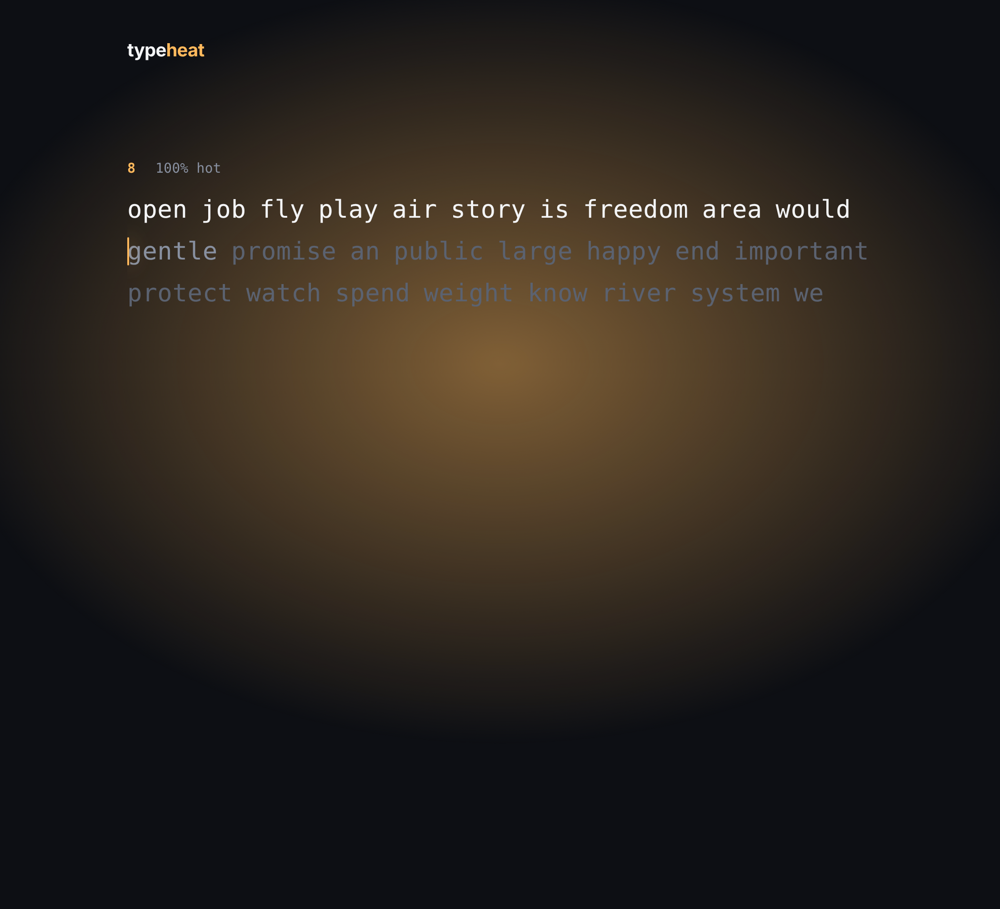
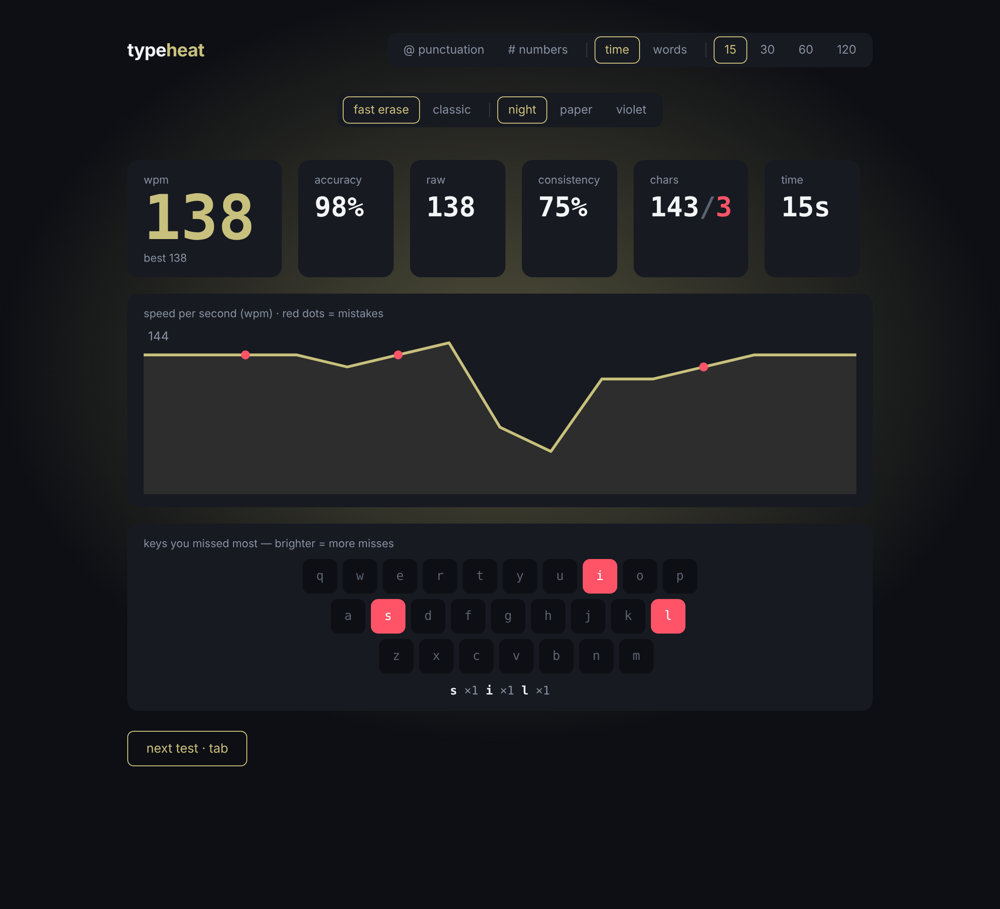

<div align="center">


**A minimal typing test where your speed heats up the screen.**

[**Live demo**](https://Sabyasachi-Kashyap.github.io/typeheat/) · [Features](#features) · [Getting started](#getting-started) · [How it works](#how-it-works) · [Roadmap](#roadmap)




</div>

---

## Why typeheat?

Most typing tests make you hold Ctrl and Backspace together just to delete one bad word, and they only tell you your WPM at the end. typeheat is built around two ideas:

1. **One key to erase a word.** Plain `Backspace` can delete the whole word you are on. No second key, no losing rhythm.
2. **Feedback you can feel while typing.** The glow behind the text and the caret shift from cool teal to amber as your speed climbs, then fade when you slow down. You see your pace without looking at a number.

It stays quiet otherwise: no ads, no accounts, no popups. Settings fade out the moment you start typing.

## Features

| | |
|---|---|
| **Modes** | Time (15 / 30 / 60 / 120 s), words (10 / 25 / 50 / 100), **practice** (words built from your weakest letter pairs), **code** (Python or JavaScript tokens) and **text** (paste your own text, or use a sample) |
| **Text options** | Punctuation and numbers toggles on a 500-word English list |
| **Adaptive practice** | Each test updates a per-browser profile of the letter pairs you miss or type slowly. Older tests fade, so the profile follows recent form |
| **Finger analysis** | Accuracy per finger (left pinky to right pinky) for each test |
| **Letter pairs** | The pairs you missed most or typed slowest in a test, with average gap in ms |
| **Backspace** | *Fast erase* (Backspace deletes a word) or *classic* (Backspace deletes a letter, `Ctrl/Alt+Backspace` deletes a word) |
| **Heat effect** | Glow, caret and live "% hot" readout driven by your last ~2 seconds of typing |
| **Endless text** | In time mode, words keep scrolling in, so you never run out before the timer does |
| **Results** | WPM, raw WPM, accuracy, consistency, correct/wrong characters, speed-per-second chart |
| **Missed-key heatmap** | A keyboard that lights up the keys you get wrong most |
| **Personal bests** | Saved per mode and setting in your browser |
| **Themes** | night, paper, violet |
| **Text size** | Small, medium or large |
| **Readable font** | Switches to Atkinson Hyperlegible, designed to make letters easier to tell apart |
| **Wrong letters** | Mistakes are underlined as well as coloured, so they stand out without relying on colour |
| **Accessibility** | Caret and button transitions turn off under `prefers-reduced-motion`; a hidden input lets phones type |

<div align="center">

</div>

## Keyboard shortcuts

| Key | Action |
|---|---|
| `Tab` or `Esc` | Restart with a fresh set of words |
| `Backspace` | Delete a word (fast erase) or a letter (classic) |
| `Ctrl` / `Alt` + `Backspace` | Delete a word in classic mode |
| `Space` | Commit the current word and move on |
| `1` / `2` / `3` | After a test: this test, progress, compare |
| `T` | After a test: show or hide the data table |

## Getting started

**Requirements:** Node.js 18 or newer.

```bash
git clone https://github.com/Sabyasachi-Kashyap/typeheat.git
cd typeheat
npm install
npm run dev
```

Open the URL Vite prints (usually http://localhost:5173) and start typing.

| Script | What it does |
|---|---|
| `npm run dev` | Start the dev server with hot reload |
| `npm run build` | Create a production build in `dist/` |
| `npm run preview` | Serve the production build locally |
| `npm test` | Run the unit tests for scoring, analysis and practice selection |

## How it works

**Scoring**

- **WPM** = correct characters ÷ 5 ÷ minutes. A word only counts when it is typed correctly, spaces included.
- **Raw WPM** = every typed character ÷ 5 ÷ minutes, mistakes included.
- **Accuracy** = correct keystrokes ÷ total keystrokes. A mistake you later fix still counts against you.
- **Consistency** = 100 minus the coefficient of variation of your per-second speed. A steady pace scores higher.

**Heat**

Each keystroke is logged with a timestamp. The heat target is your correct-keystroke rate over the last 2.2 seconds, scaled so 110 WPM is 100%. Every animation frame the displayed value eases toward that target, and it decays on its own if you pause for more than about 600 ms.

**Performance decisions**

- The heat animation runs in a single `requestAnimationFrame` loop that writes straight to the DOM (CSS variables and inline styles). It never touches React state, so it causes no re-renders at 60 fps.
- Typed text and the current word index live in one state object, updated atomically on each keystroke. Keeping them separate caused a crash when keys arrived faster than React could sync them.
- Each word is a memoized component, so a keystroke re-renders only the word you are typing, and new words are generated 60 at a time when fewer than 40 remain.
- The caret position is read from layout offsets, not from bounding rectangles mid-transition, so it never lags behind the text.

## Project structure

```
typeheat/
├── .github/workflows/deploy.yml   # build + publish to GitHub Pages on push to main
├── docs/                          # README screenshots
├── src/
│   ├── App.jsx                    # UI and the typing session
│   ├── engine.js                  # pure logic: word generation, scoring, analysis, practice (no React)
│   ├── engine.test.js             # unit tests for engine.js
│   ├── analysis.jsx               # per-finger bars and letter-pair list
│   ├── progress.jsx               # settings, history, charts and comparison panels
│   ├── words.js / code.js / passages.js   # word list, code tokens and sample passages
│   └── main.jsx                   # React entry point
├── index.html
├── vite.config.js
├── package.json
└── LICENSE
```

The typing logic lives in `engine.js`, which has no React or browser dependencies, so it can be tested with `npm test`.

## Deployment

The included workflow builds the site and publishes it to GitHub Pages on every push to `main`.

1. Push the repo to GitHub.
2. Go to **Settings → Pages** and set **Source** to **GitHub Actions**.
3. Your site is live at `https://Sabyasachi-Kashyap.github.io/typeheat/` after about a minute.

`vite.config.js` uses `base: "./"`, so the build works under any repository name without changes.

## Roadmap

- [x] Time and words modes, punctuation and numbers
- [x] Fast-erase backspace
- [x] Heat effect
- [x] Results with chart and missed-key heatmap
- [x] Themes and personal bests
- [x] Mobile and touch support (hidden input field; not yet tested on a real phone)
- [x] Remember theme, mode and settings between visits
- [x] Practice mode that drills your weakest letter pairs
- [x] Custom text (paste your own) and sample passages
- [x] Code-typing mode (Python and JavaScript tokens)
- [x] Accessibility: text size, readable font, underlined mistakes
- [x] Unit tests for the scoring and practice logic
- [ ] Larger, frequency-ranked word lists
- [ ] Bigram heatmap across the keyboard
- [ ] Sound and caret style options
- [ ] Accounts, history and leaderboards (needs a backend)
- [ ] Multiplayer races

## Known limitations

- Touch support is basic and has not been tested on real phones. Some keyboards may behave differently.
- Code mode types space-separated tokens, so indentation and line breaks are not modelled yet.
- Personal bests, letter-pair profile and settings are stored in your browser's `localStorage`, so they are per device and cleared with site data.
- Fonts (Manrope and JetBrains Mono) load from Google Fonts. Offline, the app falls back to system fonts.

## Feedback

Bug reports and feature ideas are welcome as GitHub issues. Code contributions are not accepted, since the project is closed-source.

## License

Copyright © 2026 Sabyasachi Kashyap. All rights reserved.

This is proprietary software. The source is visible for reference only, and no permission is granted to copy, modify, distribute or use it without written permission. See [LICENSE](LICENSE) for the full terms.
